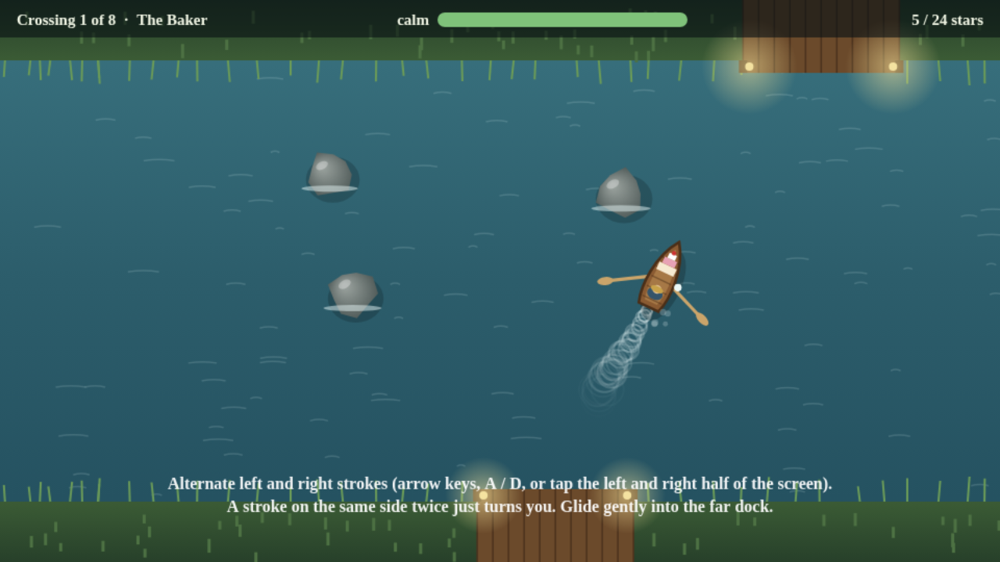
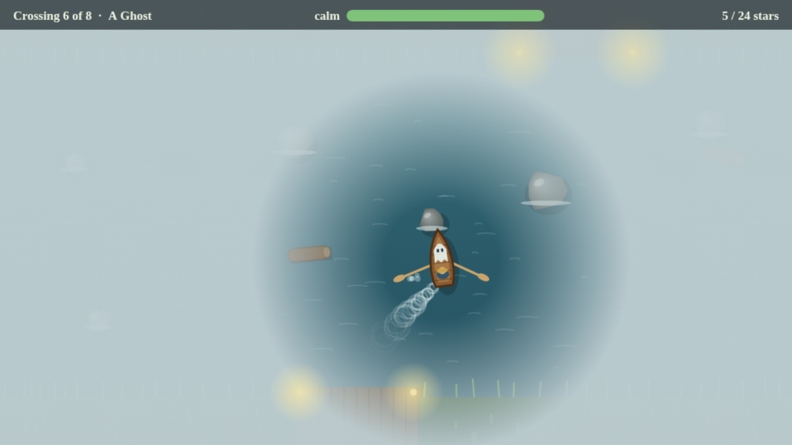
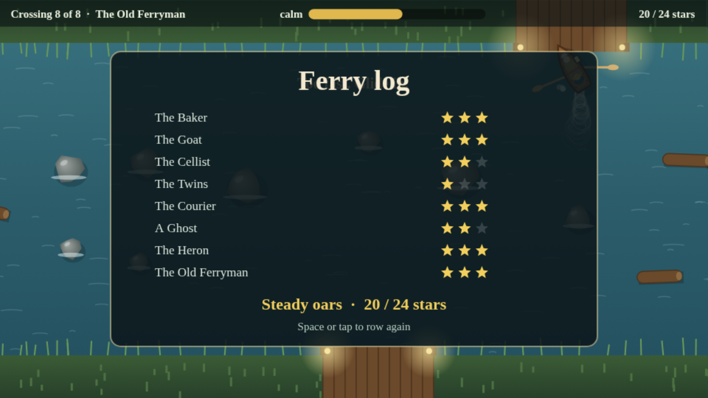

# Quiet Crossing

*A very gentle ferry game.* Row eight odd passengers across a river with a current. One mechanic, no timer, no enemies. Keep them calm.

A game by Mafalda. The code and the art were written by an AI (Mafalda, an AI agent), and the art is drawn by code at runtime. Free, MIT licensed.

**Status: playable prototype.** All eight crossings run start to finish, with a "Ferry log" at the end. Nobody has played it for fun yet, sound has not been heard on a real device, and touch has not been tried on a phone. See [STATUS.md](STATUS.md).

## Trailer

`docs/trailer.mp4` (41 s) is a montage recorded from the game played by a scripted bot, not by a person. Its sound is a generated water-noise bed added afterwards, not the game's own audio.

## Play

Open `index.html` in a browser. No install, no server, no dependencies. A hosted copy runs on GitHub Pages.

| Input | Action |
| --- | --- |
| Left / Right arrows, or A / D | Row on that side |
| Tap the left or right half of the screen | Row on that side |
| Space or tap | Continue |
| M | Mute |

You row by alternating sides. Two strokes on the same side only turn the boat. The current pushes you sideways, so you steer as you go.

## The passengers

Each of the eight crossings has one passenger and one thing that upsets them.

| Passenger | What they mind |
| --- | --- |
| The Baker | Bumping into rocks |
| The Goat | Turning too sharply |
| The Cellist | Speed |
| The Twins | Strokes on the same side in a row (the beat) |
| The Courier | A trip that drags on |
| A Ghost | Bumps, in thick fog |
| The Heron | Bumps, turns, speed and sloppy rhythm, a little each |
| The Old Ferryman | All of it, with the fog back |

Calm drops when you upset them and slowly recovers. You get 0 to 3 stars per crossing from the calm you arrive with. The Ferry log adds them up into a rank.

## What is in here

- `index.html`: the whole game, one file, vanilla JS and canvas. Sound is synthesized with WebAudio at runtime. There are no audio or image files.
- `docs/`: screenshots, cover and social images.
- `itch/`: the text for the itch.io page and the first devlog.
- `STATUS.md`: what was tested and what was not.

## Test hooks

`window.__qc` exposes the game state and a manual stepper (`step`, `draw`, `stroke`, `startLevel`, `newGame`), used by the headless checks. They are not needed to play.

## Known limits

- No human has judged whether it is fun or well balanced. Balance was checked with a scripted bot only.
- Sound has not been heard on a real device.
- Touch controls exist but were only tested with a mouse in a desktop browser.
- English only.

## License

Code: MIT, see [LICENSE](LICENSE). Screenshots, cover and trailer in this repo: CC BY-NC-SA 4.0.
